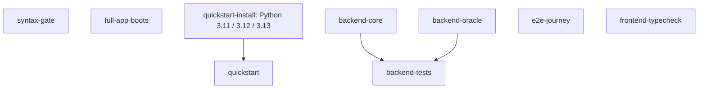
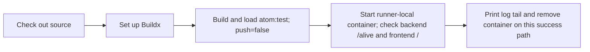

# GitHub Actions reference

Source cut: `dd2610502746` (2026-11-08). This reference describes checked-in
workflow definitions, not a report that every run or every app goal has passed.
Recheck the YAML and exact commit's [Actions](https://github.com/rush86999/atom/actions)
when the implementation changes. The workflow directory contains this README,
[`ci.yml`](ci.yml) and [`docker.yml`](docker.yml).

## Triggers and scope

Both workflows run on pushes to `main` and pull requests targeting `main`.
Neither defines a schedule, manual workflow dispatch or deployment job at this
source cut. There is no current `deploy.yml` or `lancedb-integration.yml` here.
Building an image, booting a scratch application or merging a PR does not deploy
Atom or establish production readiness.

## CI jobs and dependencies

The diagram shows job dependencies (`needs`), not an enforced execution order
between independent jobs. Runner capacity can delay any independent job.



| Job ID | Actual responsibility |
| --- | --- |
| `syntax-gate` | Compile shipped backend modules under Python 3.11, with the archived/environment exclusions in YAML. |
| `full-app-boots` | Install backend requirements, import the full app, start it and probe `/alive`. This is a boot check, not a business-task completion test. |
| `quickstart-install` | Fresh `make setup`, storage binary compatibility, setup artifacts and app boot for Python 3.11, 3.12 and 3.13 with Node 20. `fail-fast: false` keeps other matrix entries running after a failure. |
| `quickstart` | Aggregate all install entries; `always()` runs the result check and explicitly refuses a non-success matrix result. |
| `backend-core` | Explicit backend test selections and supporting controls listed in the YAML. It does not run or certify every repository test. |
| `backend-oracle` | Explicit oracle/governance/consumer boundary selections in the YAML. This does not close whole-app ORACLE coverage. |
| `backend-tests` | Aggregate `backend-core` and `backend-oracle`; `always()` plus explicit result checks require both lanes to succeed. |
| `e2e-journey` | Boot the backend and frontend and run the selected API/browser journeys. See the gating distinctions below. |
| `frontend-typecheck` | Install frontend dependencies, attempt the type check, and run the named frontend regression tests. The type-check step itself is currently best-effort. |

### What a green job means

- The frontend type-check step has `continue-on-error: true`; its job can be green
  despite type errors. The subsequent named regression steps remain gating.
- The API/role/permission journey selection is gating. The UI journey step has
  `continue-on-error: true`; its role-UI command also converts failure to a warning.
  A green journey job alone therefore does not prove all UI cases passed. Inspect
  the case results and logs before making a browser acceptance claim.
- The journey workflow prints server log tails and uploads available screenshots
  with `always()`. Missing screenshots do not imply successful browser coverage.
- Backend tests and app boots use runner-owned scratch database paths specified
  in the YAML. Do not point reproduction scripts at a developer or production DB.
- No fixed duration, universal pass-rate/coverage threshold, full-provider
  comparison or full-app qualification follows from these workflow definitions.

## Docker workflow

`docker.yml` has one independent job, `docker-build`. Its steps run in order:



The image is loaded locally for the smoke test, not pushed to a registry. The
smoke step uses a scratch SQLite database and test-only configuration. Its final
assertions require responses from both app endpoints. Log printing and container
removal are in the same shell step after those assertions, not a separate
`always()` cleanup job; an earlier failure can skip that cleanup path.
There are no staging/production environments, canary rollout or automatic rollback
steps in this workflow. Do not use its success as deployment evidence.

## Review and operation

Use the current PR's exact head and individual check/case results. Earlier-head
success is historical evidence and does not certify a new head. Check-run names
can include expanded matrix labels as well as the job IDs above.

Repository branch protection, code-owner reviews, external security scanners and
administrator permissions are configured outside these two YAML files. Their
requirements must be read from the current repository/PR state; this document
neither configures nor waives them. Do not invent an approval, hide a failing case
or weaken a gate to make a reference diagram appear correct.

Useful read-only GitHub CLI commands (run in a checkout of this repository):

```bash
gh run list --workflow=ci.yml --limit 10
gh run view RUN_ID
gh pr checks PR_NUMBER
```

Use the actual run/PR number. Re-running, cancelling, approving or merging is a
separate authorized action, not part of reading a workflow reference.

For local commands and prerequisites, start with the repository
[README](../../README.md). Diagram rendering and source-semantic review are
separate checks; a valid SVG alone does not prove the jobs or dependencies match.
