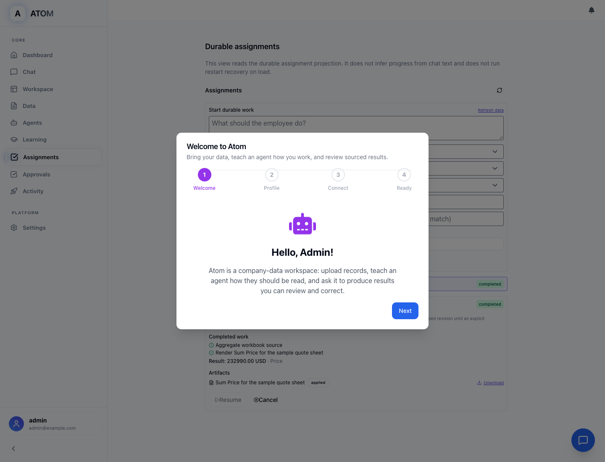

# Atom

### Teach an AI employee your business. Give it work. Come back to a result.

**Open-source AI employees for spreadsheets, documents and repeatable business work.**

[Try locally](#try-atom-locally) · [See the workflows](docs/demo/VERIFIED_WORKFLOWS.md) · [What's verified](#what-you-can-rely-on) · [Report an issue](https://github.com/rush86999/atom/issues)

## From instructions to finished work

Atom is a locally run AI employee workspace. Teach an employee your business
rules, supply company data, and ask it to calculate, assess or prepare a
deliverable. When a field or instruction is ambiguous, it asks. When work must
wait, it saves its state so you can leave and continue after a restart.

- **Teach and correct.** Save contextual lessons, field mappings, document
  formats and email protocols. New work adopts corrections; active work keeps
  its accepted teaching snapshot.
- **Work with unfamiliar data.** Upload CSV/XLSX files, confirm ambiguous column
  mappings, calculate against source records and produce cited DOCX/PPTX output.
- **Turn policy into repeatable decisions.** Author ordered rules in the canvas
  editor. Supported deterministic rules preserve unresolved requirements rather
  than inventing an approval.
- **Keep work moving.** Durable questions, approvals and waiting states survive
  restarts. Completed operations are preserved and uncertain effects require
  reconciliation before another attempt.
- **Choose your model.** Configure your own provider in Settings or use a local
  OpenAI-compatible endpoint. The sample below needs no model or cloud key.

## Try Atom locally

**Prerequisites:** Git, Make, Python **3.11–3.13** (3.11 recommended), Node.js
**20.9+** and npm. Python 3.14 is not supported by this dependency set.

~~~bash
git clone https://github.com/rush86999/atom.git
cd atom
PYTHON=python3.11 make setup
make dev
~~~

In a second terminal, from the same `atom` directory:

~~~bash
make sample
~~~

Open **http://localhost:3001**. Sign in as `admin@example.com` using the
generated password in `backend/logs/bootstrap_admin_password.txt`. Open
**Assignments** to find the completed sample and download its Word document.

**Your first result:** *Sample Quote Analyst* reads
[`sample-workspace/sample_quote.csv`](sample-workspace/sample_quote.csv),
calculates **232990.00**, and creates a DOCX. Its lessons are editable under
**Agents → Sample Quote Analyst → Training**. The sample uploads local data
and creates local records/artifacts; it sends no email and needs no connected
account or cloud credential.

If the default ports are busy, use the same pair for startup and the sample:

~~~bash
BACKEND_PORT=8101 FRONTEND_PORT=3101 make dev
# Second terminal:
make sample PORT=8101 FE_PORT=3101
~~~

Then open http://localhost:3101. Stop the development processes with **Ctrl+C**;
restart with `make dev` against the same checkout to keep your local data.
Do not delete the database or generated keys to troubleshoot an existing install.

**Measured first use:** approximately **5 min 15 s** on one fresh-worktree run
with warm package caches, including setup, startup, sample and browser access.
**15 minutes is a cold-install target, not a measured guarantee.** See the
[setup guide](docs/getting_started/quick-start.md) and
[measured first-use record](docs/demo/FIRST_USE_TEST_2026-11-01.md).

## See what an employee can do

| Workflow | What the recorded acceptance demonstrates |
|---|---|
| **Sales quote** | Unfamiliar columns → confirmed mapping → source-grounded total → formatted document; corrected teaching applies to new work. |
| **Grant review** | A second business domain uses the same teaching, calculation, clarification and artifact mechanisms. |
| **Workbook editing** | A tested 24-sheet workbook preserves identifiers and formulas through supported recalculation, export and restart/reopen. |
| **Long-running assignment** | More than two hours waiting, real backend restarts, the same assignment resumes, completed source work is retained and one controlled effect is recorded. |
| **Learn from conversations** | Review a persisted email thread, resolve referenced resources, confirm a lesson and apply it only in its accepted context. |

The [demo guide](docs/demo/VERIFIED_WORKFLOWS.md) distinguishes reproducible
steps from historical runs and lists their exact sources. The two-hour run is
elapsed/recovery evidence on its recorded source; later budget repairs have
their own focused verification.

## What you can rely on

**111 of 123 frozen functional claims (90.2%) were accepted within the documented
local and controlled-provider configurations.** This is a source-bound feature
coverage milestone, not a promise of 90% accuracy or universal reliability.

| Reference | Purpose |
|---|---|
| [`successor-first-use-2026-11-01`](https://github.com/rush86999/atom/tree/successor-first-use-2026-11-01) | Recommended reproducible snapshot with the correctness and first-use fixes. |
| [`accepted-local-2026-11-01-90pct`](https://github.com/rush86999/atom/tree/accepted-local-2026-11-01-90pct) | Immutable historical acceptance reference; its later-discovered budget defect is documented. Prefer the repaired successor for use. |
| [Acceptance and repairs](docs/acceptance/VERIFIER_ACCEPTANCE_2026-11-01.md) | Exact identities, independent checks and scope. |
| [Frozen feature inventory](docs/acceptance/readme_feature_readiness_2026-11-01/CLAIM_INVENTORY.json) | Verified, partial and excluded claims; denominator unchanged. |
| [Successor release notes](docs/acceptance/SUCCESSOR_RELEASE_2026-11-01.md) | Changes from the baseline and first-use measurements. |

To use the fixed snapshot rather than development `main`, run
`git checkout successor-first-use-2026-11-01` **before** `make setup`.

### Recent verified progress

Development `main` also includes newer, separately scoped evidence. These do
not change the frozen 111/123 score or qualify universal employee judgment.

| Capability | Verified boundary |
|---|---|
| **Information-triggered continuation** | An ordinary source-answer UI episode preserved the same task, wait and source version through a real restart; an authorized answer triggered continuation to one verified task effect and final UI. Model responses were controlled, not a model-quality benchmark. |
| **Goal controls** | Ordinary UI goal set, ranking, reload and clear, with a member read-only/refusal twin. Analytics history used synthetic fixtures. |
| **Backup and restore** | A normal application child-process restart verified restored records and exact document bytes in an isolated local world; this is not whole-app disaster-recovery or crash-durability qualification. |
| **Model-routing feedback** | Scoped business verdicts and shared conditional updates have SQLite and targeted PostgreSQL verification. Grounding support, unresolved decisions and satisfied business outcomes remain distinct. Served multi-model quality is still open. |

See the [current completion and evidence map](docs/engineering/APP_COMPLETION_STATE_2026_11_07.md)
for exact source identities, retained negative results and remaining requirements.

### Long-running coordination: the product goal

A task should be able to request a missing fact from an authorized person or
system, wait durably without repeated prompting, continue independent work,
and resume the same task when the relevant information arrives—even after a
restart. It may need several request/wait/resume cycles before delivering a
verified result. This is a **general app goal with bounded demonstrations**,
not a claim of universal autonomous coordination or live third-party outreach.

For example, a customer quote may depend on a vendor's availability, price and
lead time. Once authorized information arrives, dependent work should calculate
landed cost and the taught margin or markup, then prepare a quote with supported
lead-time assumptions. Procurement is only an illustration: the same mechanism
must handle dependencies, facts and outputs across domains. It must never invent
missing values, treat an unanswered request as completion, or send/order/spend
without the required authority. See [TASK-WAIT-01 acceptance requirements](docs/acceptance/GOAL_COMPLETION_DELTA_2026_11_06.md#task-wait-01--long-running-tasks-pause-for-information-and-resume-on-its-arrival).

### Clear boundaries

- The demonstrated local topology is **single worker**. Multi-worker execution
  and long soak behavior are not qualified.
- The sample and main acceptance campaigns use local or controlled providers.
  Deterministic taught policy is qualified separately from discretionary model
  judgment; the tested small-model judgment configuration failed qualification.
- **One specifically authorized Outlook send and Microsoft read-only ingestion
  were separately qualified.** That does not qualify every connector, broader
  live sending, autonomous live sending or independent recipient delivery.
- Supported workbook formulas and taught schemas are bounded. Arbitrary Excel
  compatibility, arbitrary schema understanding and UI-taught rounding are not
  promised.
- The broader platform includes workflow, routing, graph, governance and
  integration surfaces. Some need `ATOM_PRODUCT_PROFILE=full`, a configured
  provider or additional infrastructure. Consult the inventory before relying
  on a particular feature.

## Connect your own data and models

After the sample, open **Settings** to configure a provider and the connections
you need. Provider usage and connector access depend on your account and
permissions. Keep credentials out of issues, screenshots and commits.

For local inference, see [Run with Ollama](docs/getting_started/run-with-ollama.md).
For connected Office work, see [Office automation](docs/guides/ATOM_OFFICE_AUTOMATION_GUIDE.md)
and [OAuth setup](docs/guides/OAUTH_QUICK_SETUP_GUIDE.md). Local storage does not
make cloud inference private: data sent to a configured provider follows that
provider's terms.

## Documentation and contributing

- [Documentation hub](docs/README.md) · [Quick start](docs/getting_started/quick-start.md)
- [Verified workflow walkthroughs](docs/demo/VERIFIED_WORKFLOWS.md)
- [Troubleshooting](docs/getting_started/TROUBLESHOOTING.md)
- [Architecture](docs/architecture/README.md) · [Security boundaries](docs/security/TRUST_VS_SANDBOX.md)
- [Brennan business-workflow engineering orders](docs/engineering/brennan/README.md)
- [Contributing](CONTRIBUTING.md) · [Open an issue](https://github.com/rush86999/atom/issues)

For a useful bug report, include the commit/tag, operating system, launch
command, expected result and a minimal sanitized example. Please do not include
passwords, tokens, private documents or your database.

Atom is already public on GitHub under [AGPL v3](LICENSE.md). Hosted deployment
is separate from the verified local setup. If this project helps your work,
**star the repository, try a real workflow and tell us where it gets stuck.**
