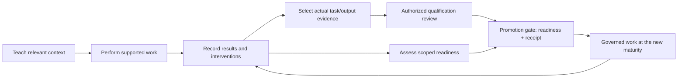

# Agent training and graduation

For the comprehensive reference, see the [Agent Graduation Guide](graduation.md).

Atom connects teaching with evidence and controlled responsibility. You teach
an agent the relevant business context, inspect its work, and use recorded
performance to assess whether it is ready for more independent work.
Graduation changes maturity within the governance system; each action still
needs its own permissions, scope and applicable approvals.

## From training to responsibility

1. **Teach the work.** Save accepted lessons, mappings, terms and output
   instructions. The [teach-and-correct walkthrough](../demo/VERIFIED_WORKFLOWS.md#teach-and-correct)
   demonstrates scoped corrections and the teaching snapshot retained by an
   active assignment.
2. **Observe actual work.** Completed tasks, episodes, verified results,
   feedback and interventions provide evidence. Saving a lesson alone does
   not prove that the agent can perform a new task.
3. **Review readiness.** Agent-level readiness evaluates scoped episode
   evidence and the criteria for the requested next level. Missing evidence
   or unresolved gaps must not be treated as a passing assessment. Readiness
   is necessary but not sufficient for promotion.
4. **Review actual work.** Select explicit task/context plus actual durable
   output evidence and request a scoped capability qualification review. A
   current authorized reviewer decides it in the ordinary Approvals queue.
   Historical statistics and a legacy exam pass are not a qualification.
5. **Apply an authorized promotion.** The public promotion route requires a
   current supervisor-grade reviewer, checks the reviewed agent, experience
   readiness and the qualification receipt (or an explicit current owner
   exception), then records the decision. Refresh the authoritative result
   before relying on the new status.
6. **Continue oversight.** Corrections and regressions can restrict capability
   maturity. More autonomy does not remove data access checks, action policy,
   budgets, required human checkpoints or execution boundaries.

## Two related maturity records

| Record | What it describes | Current mechanism |
|---|---|---|
| Agent maturity | Overall stage: STUDENT → INTERN → SUPERVISED → AUTONOMOUS | Scoped readiness and an authorized promotion decision for the next stage |
| Capability maturity | The stage of a particular capability | Verified-success accounting, correction/regression epochs and capability-specific progression |

Agent-level readiness uses episode counts, intervention rates and recorded
compliance scores. Its configured criteria are in
[`AgentGraduationService.CRITERIA`](../../backend/core/agent_graduation_service.py).
Counts alone do not establish readiness. The public historical exam endpoint
reviews authorized recorded traces; it is not fresh qualification of an
unseen task or proof of general competence.

Capability progression uses new verified successes in the relevant epoch.
The current implementation has 5/20/50-success rungs; a reset or revocation
prevents an old lifetime streak from immediately restoring autonomy. See
[`CapabilityGraduationService`](../../backend/core/capability_graduation_service.py)
for the applicable reset and re-entry conditions. An AUTONOMOUS label is a
maturity state, not unlimited authority or a guarantee of correct judgment.

## Scoped capability qualification

An agent-level promotion needs a current qualification receipt for the actual
candidate work, unless the owner policy explicitly marks the target tier as not
required or names the exact agent in an owner exception.

1. `GET /api/episodes/graduation/qualification/evidence/{agent_id}?target_maturity=INTERN`
   returns eligible task/context plus actual durable output bundles. History-only
   episodes are excluded; the reviewer must select the bundle explicitly.
2. `POST /api/episodes/graduation/qualification/request` creates an
   `agent_qualification_review` HITL action. It does not promote.
3. `POST /api/agents/approvals/{action_id}` records the authorized human
   decision. Only an approved review creates a passed receipt.

A receipt is bound to the exact agent, current/target tier, tenant/workspace,
owner-policy revision and digest, rubric version and criteria, source revision,
normalized evidence and reviewer. A policy, rubric, scope, source or evidence
change makes the old review stale; the old review fails closed and a fresh
review is required. Missing, failed, stale, foreign or unreadable assessment
material is never treated as allowed or "Ready".

The default rubric is human review v1 and includes semantic task
completion/correctness against the expected or evidence result. There is no
model judge and no separate score engine.

## Owner policy limits

The strict owner setting is `ATOM_GRADUATION_ASSESSMENT_POLICY`. Supported
controls are `default_required: true`, per-tier gates, empty exception `domains`
lists, and exceptions that name exact `agent_ids` with a nonblank reason.
Rubric criteria must be nonempty and have exactly unique ids.

The following are explicitly rejected as `configuration_required`, not silently
ignored: `default_required: false`, any nonempty `exceptions.*.domains`, an
empty rubric, and duplicate rubric criterion ids. Do not advertise domain
selectors as effective exemptions. No broad exemption is inferred from mutable
agent category, name or metadata.

## Promotion side effects and replay

After a promotion is durably committed, the service persists one internal
`agent_graduated` notification. The call is awaited inside the promotion
coroutine; no second event loop or background runner is created. A duplicate
operation replay returns the original outcome without a second notification.
If the notification is unavailable, the promotion stays committed and the
failure is logged; delivery is not fabricated and the tier is not rolled back.
External email remains opt-in.

## Finding the system

Start with **Agents → select an agent → Training** for lessons and training
history. The existing training/approvals UI consumes the maturity API; the
available controls depend on the release profile and your role.

For engineering reference, the authenticated episode API exposes:

- `GET /api/episodes/graduation/readiness/{agent_id}` (includes the current
  assessment state and eligible evidence bundles)
- `GET /api/episodes/graduation/qualification/evidence/{agent_id}`
- `POST /api/episodes/graduation/qualification/request`
- `POST /api/agents/approvals/{action_id}` (ordinary HITL review decision)
- `POST /api/episodes/graduation/exam` (legacy historical traces only)
- `POST /api/episodes/graduation/promote`
- `GET /api/episodes/graduation/audit/{agent_id}`

Use the [route definitions](../../backend/api/episode_routes.py) for current
parameters and authority checks, and the
[web maturity client](../../frontend-nextjs/lib/maturity-api.ts) for response
handling. An uncertain or unverified write is not a confirmed promotion.

## Evidence and limits

The repository includes focused
[authority](../../backend/tests/test_graduation_authority_boundary.py),
[evidence-scope](../../backend/tests/test_graduation_evidence_scope.py) and
[revocation](../../backend/tests/test_autonomy_revocation.py) controls. These
are controlled mechanism checks, not an ordinary-UI journey, live
model-competence campaign or full app acceptance; their presence does not
certify every agent, model, business domain or deployment. The
[app requirement audit](../engineering/APP_COMPLETION_REQUIREMENT_AUDIT_2026_11_07.json)
and [later progress reconciliation](../engineering/APP_COMPLETION_WEB_RECONCILIATION_2026_11_09.json)
retain the acceptance scope and remaining goals.

The end goal is unrestricted autonomy, with domain-specific exceptions for
required approval, restricted actions or supervision. General employee-like
judgment and broad autonomous competence remain goals.
Training here supplies reusable lessons and context; it does not imply model
weight fine-tuning or automatic mastery of private business data.
